## Actividad 1

```java
Desarrollo (Java):
```

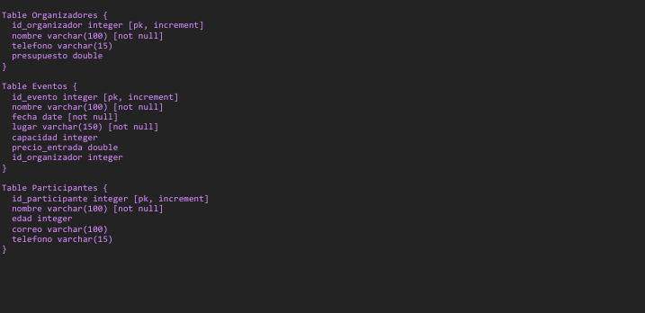

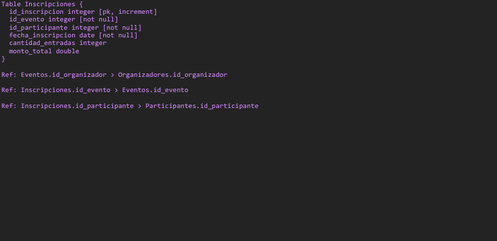

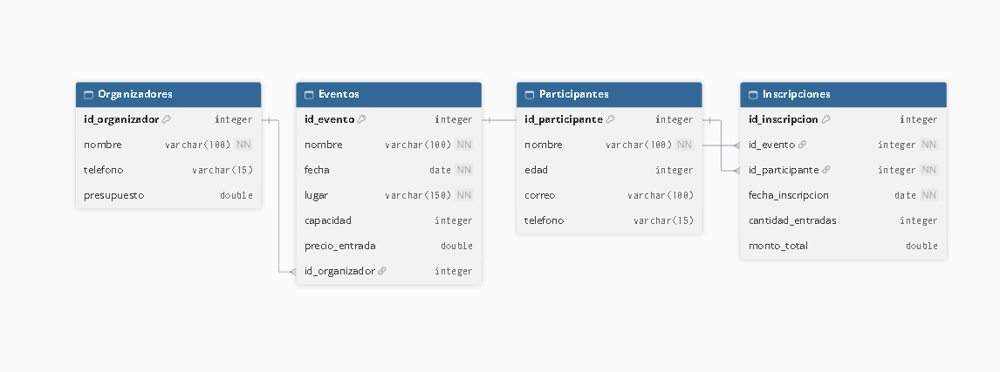

## Ejercicio 1

```java
Desarrollo:
```

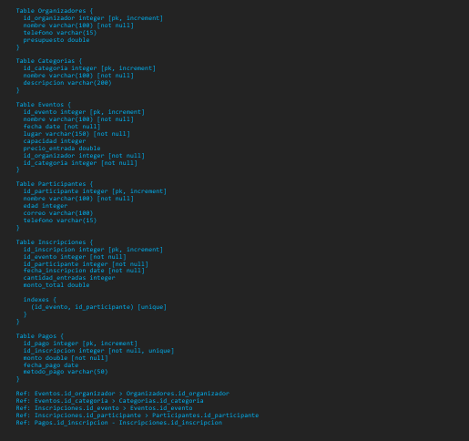

## Ejercicio 2

```java
Desarrollo:
```

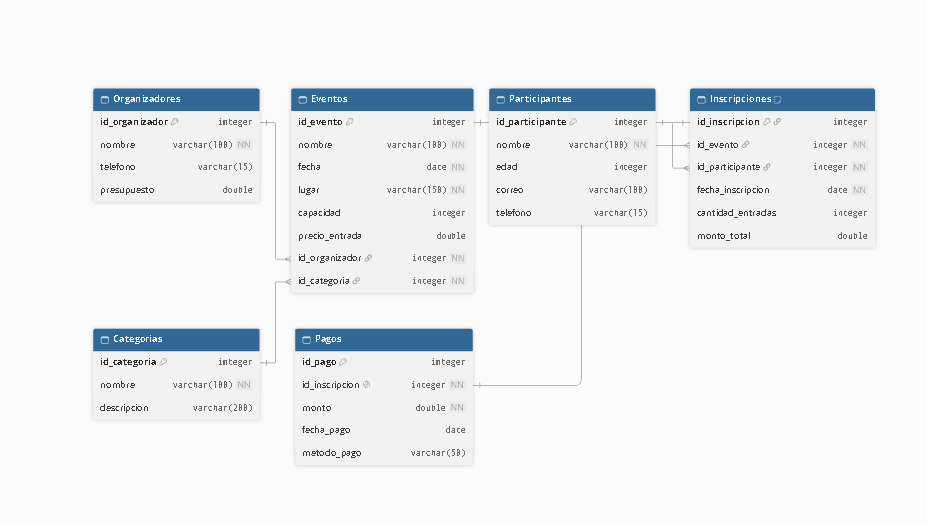

## Ejercicio 3

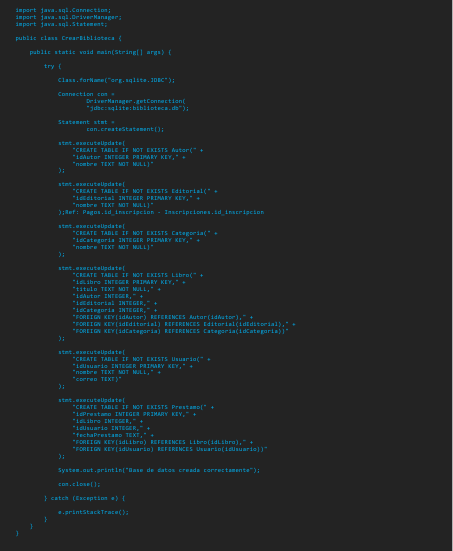

```java
b) Ingresen información a la base de datos mediante el uso de query (mínimo 10 registros por tabla) 
```

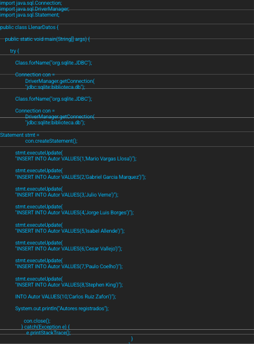

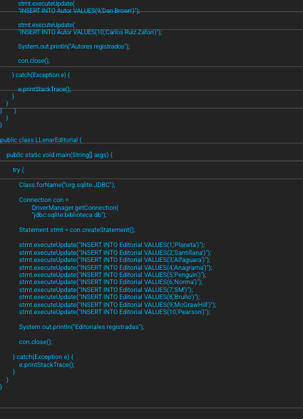

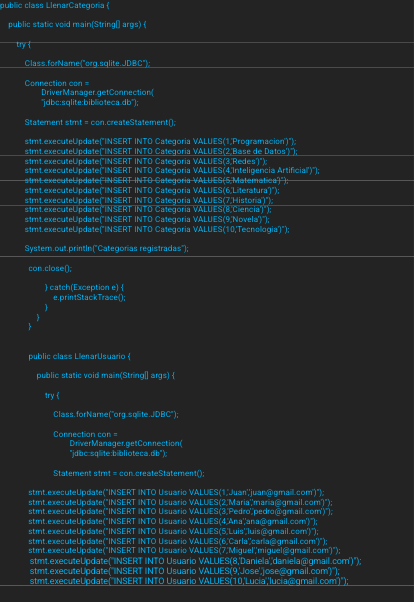

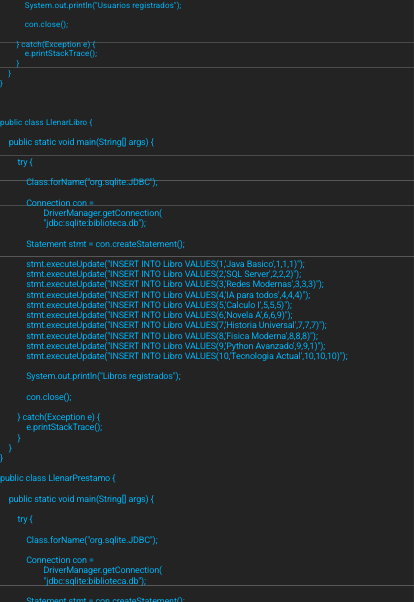

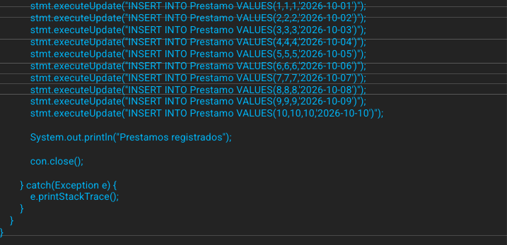

```java
c) Creen al menos 7 consultas con condicionales que utilicen una o varias tablas.
```

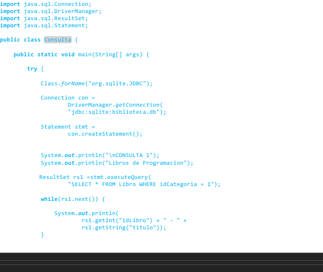

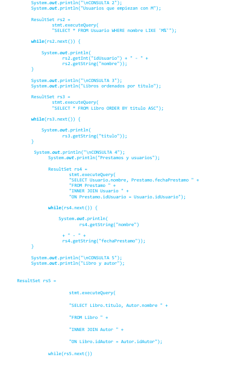

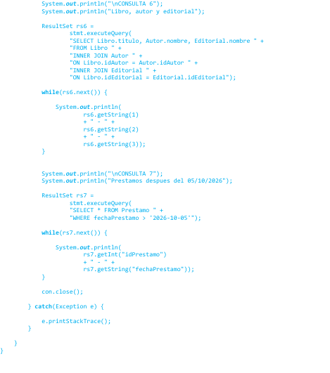

```java
d) Realicen al menos 3 actualizaciones de datos con un filtro establecido por ustedes. 
```

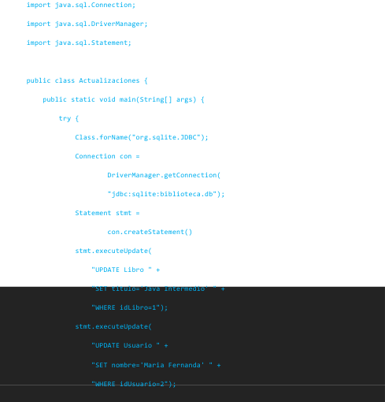

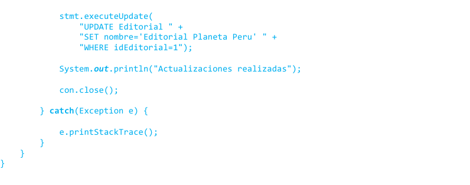

```java
e) Realicen al menos 3 eliminaciones de datos con filtros definidos por ustedes y considerando 
las referencias establecidas en las tablas.
```

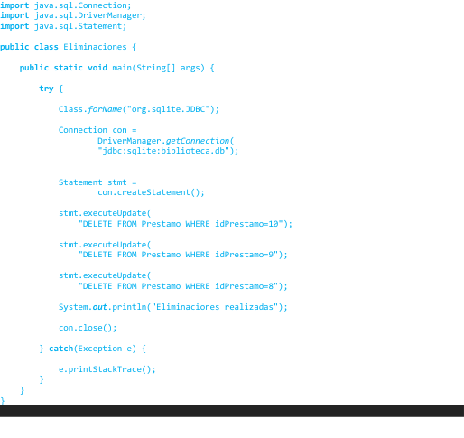

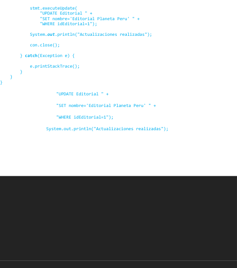

## Ejercicio 4

```java
Desarrollo (Java):
```

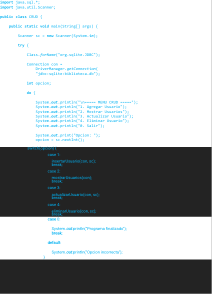

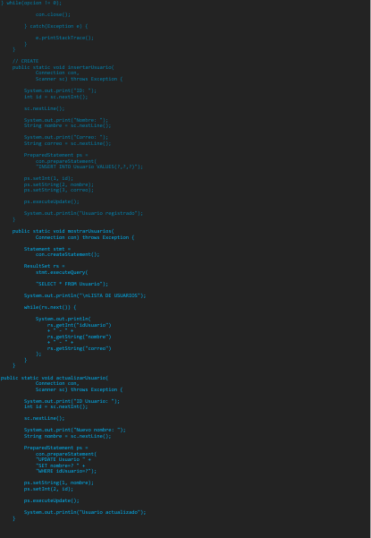

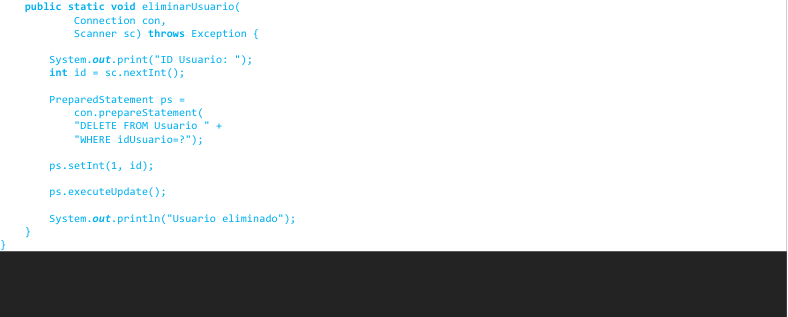

## Ejercicio 5

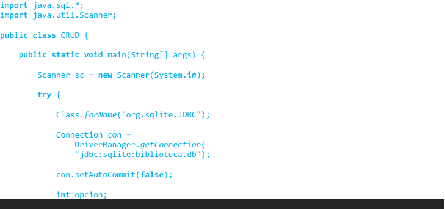

```java
   do {
                System.out.println("\n===== MENU CRUD =====");
                System.out.println("1. Agregar Usuario");
                System.out.println("2. Mostrar Usuarios");
                System.out.println("3. Actualizar Usuario");
                System.out.println("4. Eliminar Usuario");
                System.out.println("0. Salir");
                System.out.print("Opcion: ");
                opcion = sc.nextInt();
                switch(opcion) {
                    case 1:
                        insertarUsuario(con, sc);
                        break;
                    case 2:
                        mostrarUsuarios(con);
                        break;
                    case 3:
                        actualizarUsuario(con, sc);
                        break;
                    case 4:
                        eliminarUsuario(con, sc);
                        break;
                    case 0:
                        System.out.println("Programa finalizado");
                        break;
                    default:
                        System.out.println("Opcion incorrecta");
                }
            } while(opcion != 0);
            con.close();
        } catch(Exception e) {
            e.printStackTrace();
        }
    }
    // CREATE
    public static void insertarUsuario(
            Connection con,
            Scanner sc) throws Exception {
        System.out.print("ID: ");
        int id = sc.nextInt();
        sc.nextLine();
        System.out.print("Nombre: ");
        String nombre = sc.nextLine();
        System.out.print("Correo: ");
        String correo = sc.nextLine();
        PreparedStatement ps =
            con.prepareStatement(
            "INSERT INTO Usuario VALUES(?,?,?)");
        ps.setInt(1, id);
        ps.setString(2, nombre);
        ps.setString(3, correo);
        ps.executeUpdate();
        if(validarClave(sc)) {
            con.commit();
            System.out.println(
                "Usuario registrado correctamente");
        } else {
            con.rollback();
            System.out.println(
                "Clave incorrecta. Registro cancelado");
        }
    }
    // READ
    public static void mostrarUsuarios(
            Connection con) throws Exception {
        Statement stmt =
            con.createStatement();
        ResultSet rs =
            stmt.executeQuery(
            "SELECT * FROM Usuario");
        System.out.println("\nLISTA DE USUARIOS");
        while(rs.next()) {
            System.out.println(
                rs.getInt("idUsuario")
                + " - " +
                rs.getString("nombre")
                + " - " +
                rs.getString("correo")
            );
        }
    }
    // UPDATE
    public static void actualizarUsuario(
            Connection con,
            Scanner sc) throws Exception {
        System.out.print("ID Usuario: ");
        int id = sc.nextInt();
        sc.nextLine();
        System.out.print("Nuevo nombre: ");
        String nombre = sc.nextLine();
        PreparedStatement ps =
            con.prepareStatement(
            "UPDATE Usuario " +
            "SET nombre=? " +
            "WHERE idUsuario=?");
        ps.setString(1, nombre);
        ps.setInt(2, id);
        ps.executeUpdate();
        if(validarClave(sc)) {
            con.commit();
            System.out.println(
                "Actualizacion confirmada");
        } else {
            con.rollback();
            System.out.println(
                "Actualizacion revertida");
        }
    }
    // DELETE
    public static void eliminarUsuario(
            Connection con,
            Scanner sc) throws Exception {
        System.out.print("ID Usuario: ");
        int id = sc.nextInt();
        PreparedStatement ps =
            con.prepareStatement(
            "DELETE FROM Usuario " +
            "WHERE idUsuario=?");
        ps.setInt(1, id);
        ps.executeUpdate();
        if(validarClave(sc)) {
            con.commit();
            System.out.println(
                "Eliminacion confirmada");
        } else {
            con.rollback();
            System.out.println(
                "Eliminacion revertida");
        }
    }
    public static boolean validarClave(Scanner sc) {
        sc.nextLine();
        System.out.print("Ingrese clave: ");
        String clave = sc.nextLine();
        return clave.equals("1234");
    }
}
}
}
```